# Bhūsmṛti — a planetary flux atlas

**A 3D, browser-native atlas of the last 24 hours of the global atmosphere.**  
Wind, heat, moisture, pressure and land–water fluxes on a real, zoomable Earth — built to be *read*, not just looked at.

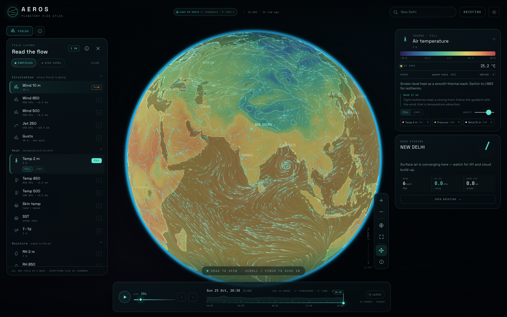

---

## Why this exists

The brief was a morning instrument: open it with coffee, watch the last day of the planet move, and build an intuition for what happens next. Existing tools were useful reference points but not quite the thing:

| Tool | What it does well | What was missing for this brief |
|---|---|---|
| **Windy** | beautiful wind particles, excellent UI | proprietary, tile service, not a flux/analysis instrument |
| **Earth Nullschool** | the canonical global wind animation | one field at a time, flat-ish projection, no multi-layer notation |
| **Ventusky / Zoom Earth** | polished weather maps | raster products, less raw-field freedom |
| **Open-Meteo / GFS** | open, global, hourly model data | no visual layer |
| **WeatherLayers / deck.gl** | GPU weather primitives | map-first, heavier, not a 3D globe |

Bhūsmṛti takes the *feeling* of Nullschool's wind map and the *information density* of a synoptic chart, puts them on an analytic 3D globe, and adds the derived quantities that actually help prediction: **advection, convergence, 3 h pressure tendency, dew-point depression**.

The result is a personal, non-commercial atlas — not a replacement for a forecast. The 24 h change is read in the **briefing** from the local sounding (temperature range, soil trend, pressure tendency) while the globe carries the motion.

---

## What you can read

**Circulation** — 10 m, 850 hPa, 500 hPa and 250 hPa wind, animated as GPU streamlines. Gusts and standard wind barbs.

**Heat** — air temperature at 2 m, 850 hPa and 500 hPa; skin temperature (land + ocean); sea-surface temperature.

**Moisture** — relative humidity at 2 m and 850 hPa, dew point, precipitable water, VPD, moisture advection, precipitation, cloud cover.

**Dynamics** — MSLP isobars with H/L centres, 3 h pressure tendency, temperature advection, surface convergence, CAPE, 500 hPa vertical motion, 500 hPa geopotential height.

**Ground** — soil moisture at 0–7, 7–28, 28–100 and 100–255 cm; soil temperature; reference evapotranspiration; snow depth; shortwave radiation.

Each layer carries its own visual grammar: a thermal wash with optional isotherms, isobars, streamlines, barbs, a soft cloud veil, a rain texture, stippled soil. The interface enforces **one wash plus linework** by default so overlays never turn to mush — extra fields become contours, glyphs or flow, not another opaque fill.

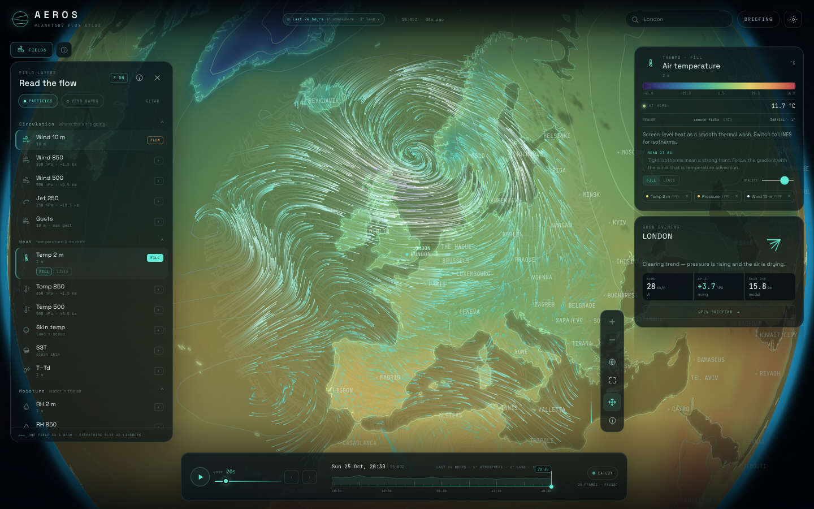

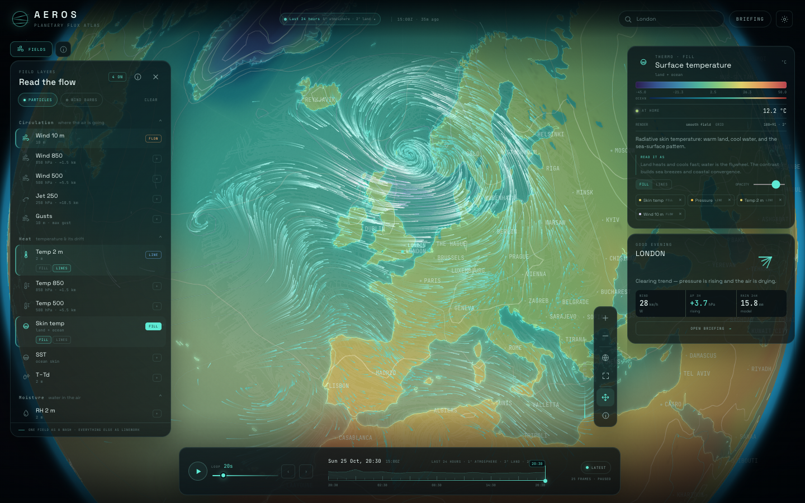

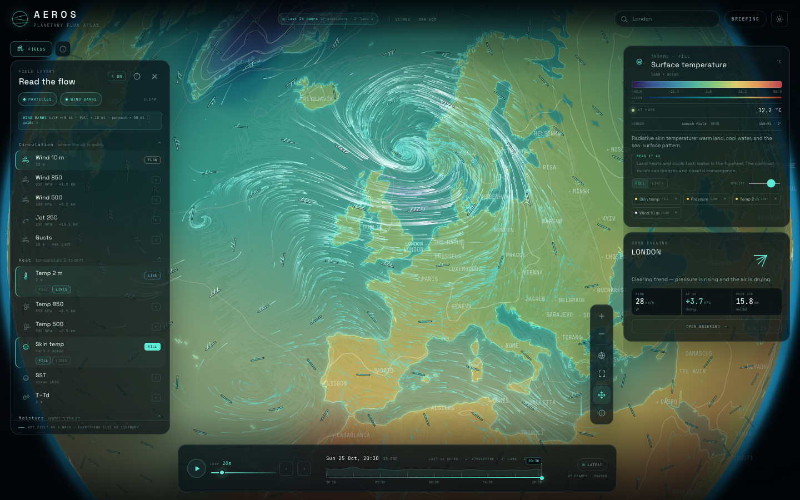

---

## Quick start

```bash
npm install
npm run dev          # http://127.0.0.1:5173
```

For the self-refreshing local app (recommended):

```bash
npm run build
npm start            # http://127.0.0.1:4173
```

`npm start` serves the built app and the live snapshot, refreshes the snapshot on boot if it is older than 6 hours, and keeps refreshing every 6 hours. The **Settings → Data → REFRESH NOW** button requests a refresh and reloads when the new snapshot is ready.

Manual refresh:

```bash
npm run refresh
```

Requirements: **Node 20+**, **Python 3 with numpy** (`pip3 install -r requirements.txt`). If `python3` does not have numpy, `scripts/refresh.sh` automatically looks for the bundled DSH runtime or set `AEROS_PYTHON=/path/to/python3`.

A cron alternative to the server:

```cron
30 5 * * * cd /path/to/geoviz && /usr/bin/env bash scripts/refresh.sh >> .cache/refresh.log 2>&1
```

---

## Using it

- **Drag** to spin the globe. Its centre never leaves the screen; at full view it spins in place.
- **Scroll / pinch** to descend from the full globe into the atmosphere. Use the hand button to turn drag-to-spin off.
- **Field guide** — the `i` button beside FIELDS, in the layer panel, or in the zoom controls opens a full glossary: pressure levels, barbs, isobars, fluxes and variable meanings.
- **Hover** to probe every active field at the cursor.
- **Timeline** — scrub, play, step one frame, or jump to the range end. `Space` toggles play; `←`/`→` step a frame. The **loop duration** slider sets how long the whole selected range takes (5–120 s); playback speed adapts automatically.
- **Time range** — the range chip in the top bar (desktop) or timeline (mobile) offers **Today, last 24 h, last 7 days, last 30 days, long archive**, and a **custom date range**. Longer ranges use coarser data and load on demand without reloading the page; the five-month archive is atmosphere-only and says so in the layer panel.
- **Layers** — click a field to activate; use `FILL` / `LINES` to change its notation. Wind fields are `FLOW` sources.
- **Search** — fly to a place and make it your home. `Use my location` uses browser geolocation.
- **Briefing** — a heuristic morning read of your home: wind, pressure tendency, rain, dew point, soil, convergence, CAPE, plus a 24 h wind rose and sparklines.
- **Settings** — a near-full-screen control room: text size, interface size, high-contrast panels, streamline density/colour, wind barbs, labels, graticule, terminator, wind units, data refresh and credits.

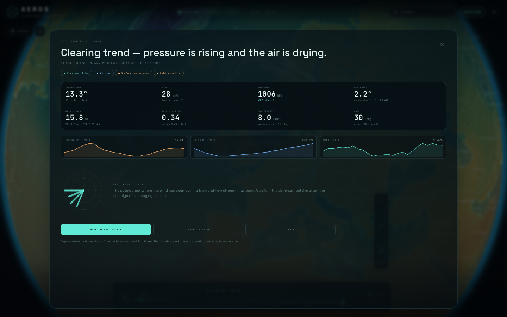

### Two visual languages

**GLOBE** is the conventional notation — one colour wash, contour lines, vectors and barbs. **EARTH** is the satellite mode: 8K satellite imagery, a field of wind-gust arrows that trail exaggerated animated smoke, and a translucent ocean whose water colour is sea-surface temperature. The arrows are coloured by wind speed; the ocean current drives the water motion. Toggle it in the top bar.

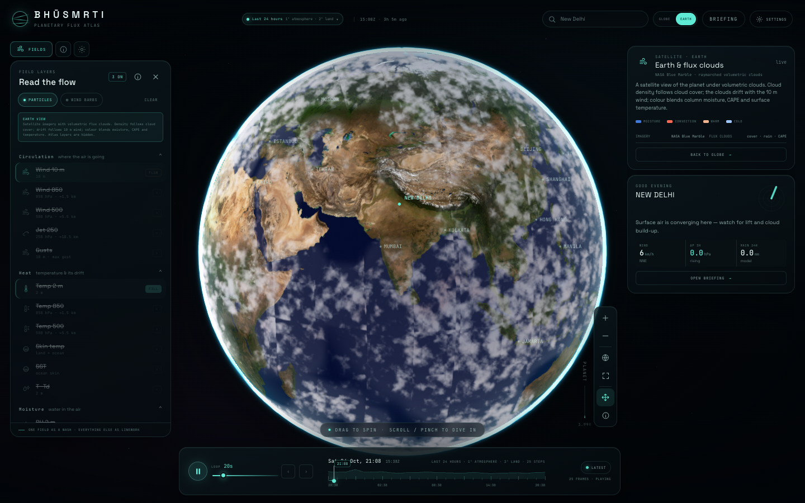

The gust field is a canvas layer over the WebGL globe: arrows sample the active flow on a coarse grid, their tails are tapered, gradient-filled, wobbling smoke strokes with drifting puffs, and they freeze with the timeline when paused. The ocean water is a full-screen WebGL pass over the ocean mask; it samples the new 2° `ocean_current_velocity` / `ocean_current_direction` fields plus SST, tints the water by temperature, and advects the surface ripples with the current. Both are driven by the timeline frame, not wall-clock, so paused means paused. The previous volumetric-cloud deck is retired from EARTH so the satellite, wind and water are visible.

The new **Ocean surface current** layer also appears under **Circulation** in GLOBE and can be selected as the flow layer; its streamlines then advect with the surface current. Ocean current data comes from the [Open-Meteo Marine API](https://open-meteo.com/en/docs/marine-weather-api) (separate quota from the land hydrology) and is available in the 24 h, 7 d and 30 d ranges. The long atmosphere archive has no ocean-current field.

FOSS survey for this mode: [CesiumJS CloudCollection](https://cesium.com/learn/cesiumjs/ref-doc/CloudCollection.html), [Eanpa-Sky](https://github.com/SkyeShark/Eanpa-Sky), [three-volumetric-clouds](https://github.com/FarazzShaikh/three-volumetric-clouds), [NASA GIBS/Worldview](https://earthdata.nasa.gov/), and the [Solar System Scope](https://www.solarsystemscope.com/textures/) 8K day map (CC BY 4.0; NASA Blue Marble 2K fallback).

Notation is locked to keep it legible: one colour wash and one flow at a time. When a type is already occupied, its button is faded and struck through; you cannot accidentally create two fills or two flow layers. **LINES** is contour-only — constant zero regions no longer flood whole countries. CAPE and snow are clean isopleths now.

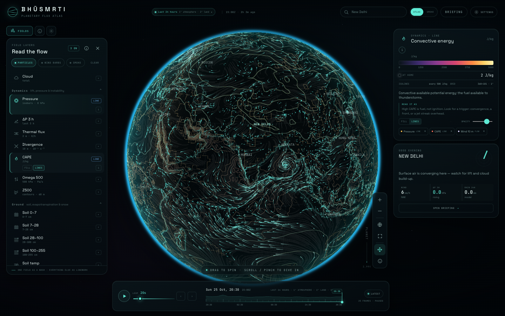

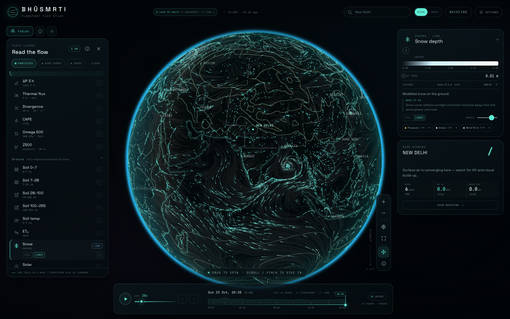

Every active/selected variable has a small **i** button (layer row, mode row, or legend) with a compact explanation. **PW** is now labelled **Precip water** and the popover explains that it is precipitable water — the total vapour in a column, in kg/m² — and why it matters.

### Time is a first-class control

The range chip selects **Today**, **last 24 h**, **last 7 days**, **last 30 days**, the **long archive** (five-month atmosphere), or a custom date range. Longer ranges are pre-built at 2°/3-hourly, 3°/12-hourly and 3°/daily and load on demand; the default 24 h stays at 1°/hourly. The loop-duration slider runs the whole range in 5–120 seconds, so a month can breathe in the same twenty seconds as a day.

The five-month archive carries the **atmosphere fields** (wind at four levels, temperature at three levels, humidity, dew point, MSLP, CAPE, precipitable water). Land and hydrology layers are available on the 24 h, 7 d and 30 d ranges; the 5-month range disables them and labels the archive **ATMOSPHERE FIELDS ONLY**. The free upstream land-data quota was exhausted while extending the archive, so the app is explicit about it rather than showing invented values.

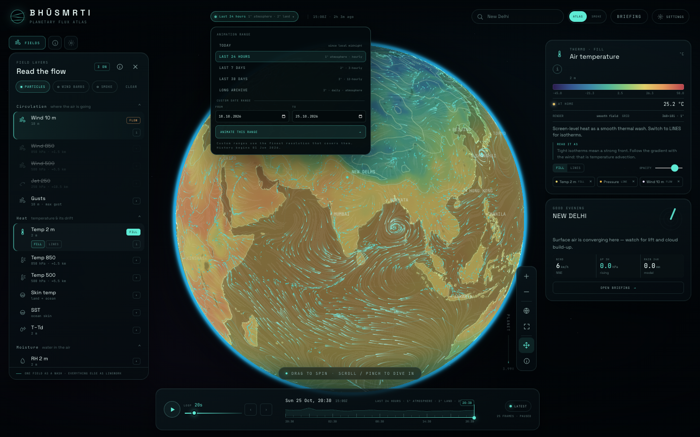

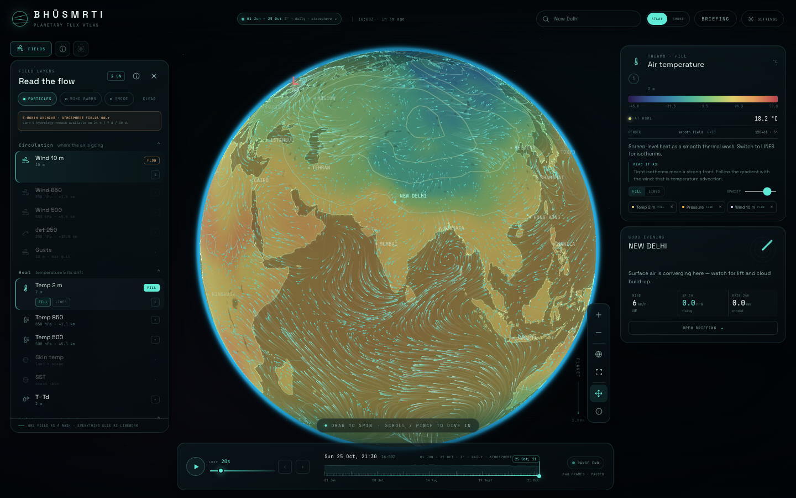

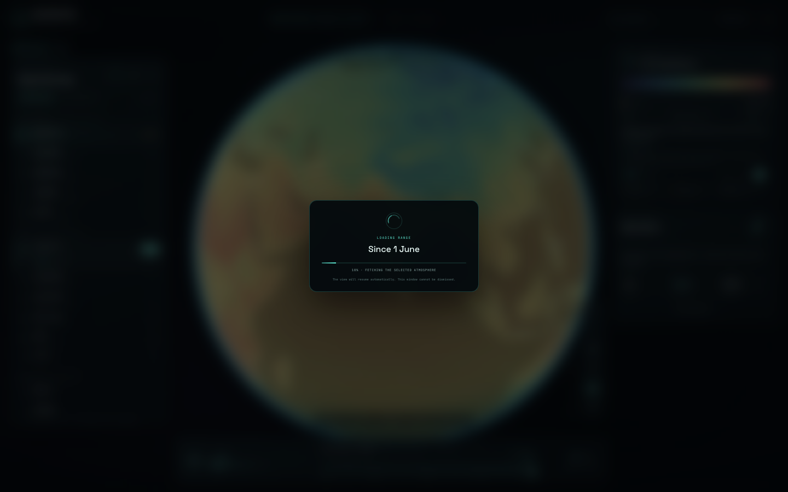

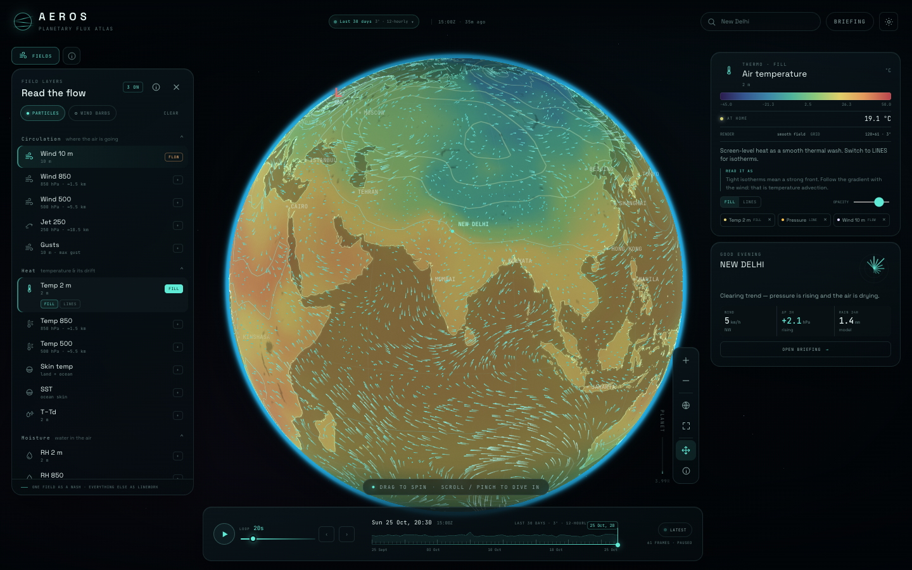

<p align="center">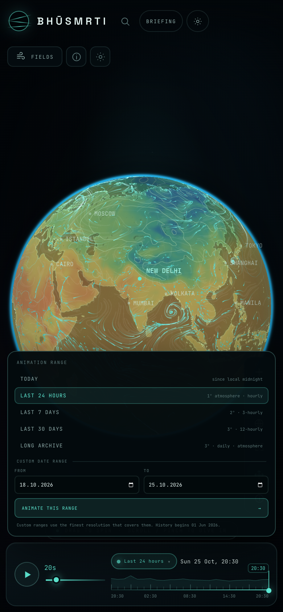</p>

### The field guide

New to a notation? The guide explains pressure levels as altitude, how to read a wind barb, the one-wash rule, and the derived fluxes that help anticipation.

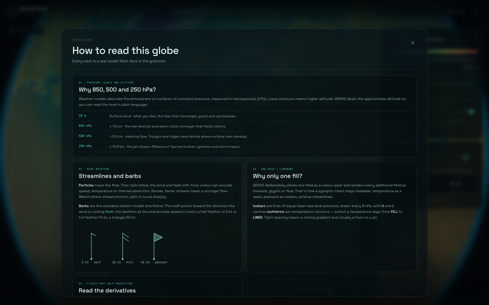

### Settings

The control room is almost full-screen: appearance (text and interface size, high contrast), flow, notation, units, data refresh and credits.

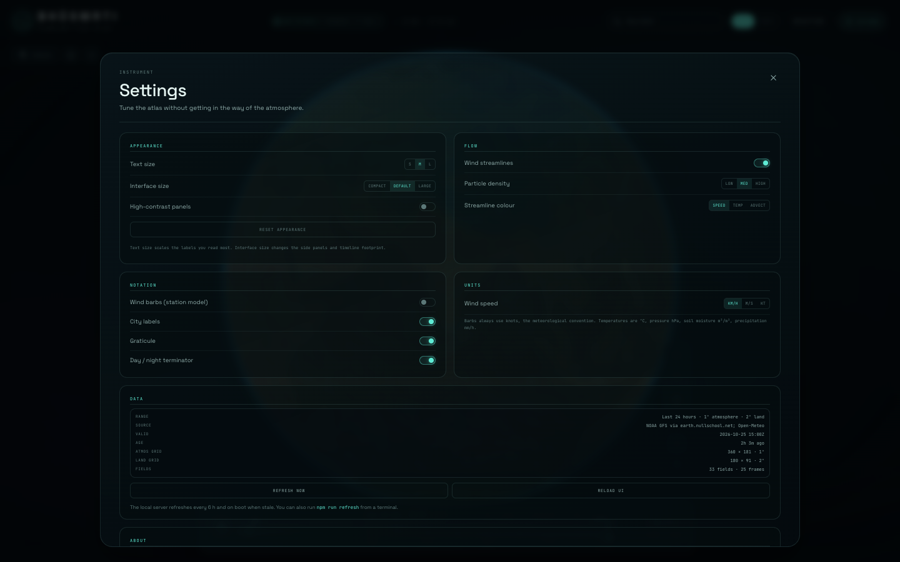

<p align="center">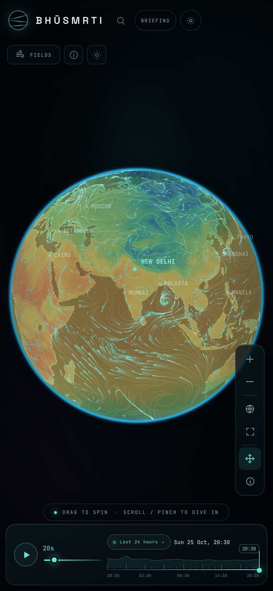</p>

---

## Data

| Layer | Source | Native grid | Frames |
|---|---|---|---|
| Atmosphere (wind, temp, RH, dew point, MSLP, CAPE, PW) | **NOAA GFS**, re-gridded by [earth.nullschool.net](https://earth.nullschool.net/) (EPak) | 1° | 25 hourly |
| Land & hydrology (skin/SST, cloud, soil, ET₀, VPD, snow, radiation, ω, Z500, gusts, precipitation) | [Open-Meteo historical forecast API](https://open-meteo.com/) | 7.5° → 2° | 25 hourly |
| Basemap | [Natural Earth](https://www.naturalearthdata.com/) 50m land/coast/lakes, 110m borders | vector | — |
| Satellite Earth | NASA Blue Marble 2K (public domain) · [Solar System Scope](https://www.solarsystemscope.com/textures/) 8K day map (CC BY 4.0) | 2K / 8K equirectangular | — |
| Ocean surface currents | [Open-Meteo Marine API](https://open-meteo.com/en/docs/marine-weather-api) `ocean_current_velocity`, `ocean_current_direction` | 7.5° sample → 2°/3° | 31 days |
| Ocean surface currents | [Open-Meteo Marine API](https://open-meteo.com/en/docs/marine-weather-api) `ocean_current_velocity`, `ocean_current_direction` at 7.5° sample points | 2° / 3° upsampled | 31 days |
| Time ranges | 24 h / 7 days / 30 days / long archive / custom | 1° hourly · 2° 3-hourly · 3° 12-hourly · 3° daily | 25 / 57 / 61 / 148 |

The snapshots are packed as per-field int16 with per-field grids and loaded on demand by range. The default 24 h range is 360 × 181 at 1° for the atmosphere and 180 × 91 at 2° for land (≈68 MB, 25 hourly frames). The 7-day range is 2° and 3-hourly (57 frames, ≈61 MB); the 30-day range is 3° and 12-hourly (61 frames, ≈29 MB); the long atmosphere archive is 3° daily (148 frames, ≈37 MB). The app decodes a field lazily on first use, caches a range in memory after its first load, and never reloads the page to switch ranges.

The EPak/PPak reader is in `pipeline/epak.py`. It reverses the binary packing documented by the public Nullschool client (variable-length integers → 2-D prefix sum → power-of-ten scale). `pipeline/build_ranges.py` builds the 24 h / 7 d / 30 d ranges (one 32-day hydrology fetch is sliced for all three); `pipeline/build_long.py` builds the 5-month atmosphere archive. `scripts/refresh.sh` runs both.

Range switches are blocking: a small non-dismissable loading card blurs and pauses the globe while the selected snapshot is fetched, then resumes automatically. Camera moves pause and clear the screen-space wind trails; the trails are rebuilt only after the zoom/pan settles, so no stale marks from the previous camera remain. Trails are clipped to the live globe disc, which keeps them out of the black space around the planet.

---

## Architecture

- **Vite + React 19** for the UI shell only. The render loop does not go through React.
- **Three.js / WebGL2** for the globe. The sphere is *analytic*: a full-screen shader intersects each view ray with a unit sphere, yielding a perfect silhouette and texture UVs with only two triangles. No tiles, no tile server, no network dependency.
- **Custom GLSL data passes** — one full-screen pass per active field, ray–sphere intersection, manual bilinear sampling of the field texture, palette, isolines with `fwidth`, ocean/land masking, per-variable texture patterns, day/night shading.
- **Wind trails** — screen-space particles advected by the flow field and painted into a persistent 2D canvas that is faded with `destination-out` every frame. That gives smooth, curved comet tails that fade naturally instead of straight polyline chords. The same wind field feeds the barbs and the hover probe.
- **Basemap baked once** from Natural Earth into a 1536 × 768 canvas: land fill, bathymetric grain, coastline bloom, borders, graticule. A vector coastline pass sits above the data for crisp edges at zoom.
- **Overlay canvas** for city labels, home marker, wind barbs, H/L centres and the probe crosshair.
- **Earth mode** — 8K satellite base, canvas wind-gust arrows with animated smoke tails (colour by speed), and a full-screen ocean-water pass sampling SST + surface current. FILL/LINES/FLOW controls are suppressed; the satellite, wind and water carry the story. The ocean current is also a normal flow layer in GLOBE.
- **Derived fields** computed on the native grid and cached per frame: advection (wind × gradient), divergence, pressure tendency, dew-point depression.
- **Snapshot** — per-field int16 + offset/scale, lazy decode, IndexedDB not needed.

The result is a render loop that is a handful of full-screen passes plus one 2D trail layer — light enough for integrated GPUs, detailed enough for a 1° global field.

---

## Honesty & limits

- GFS is a **model analysis / forecast**, not a station observation. The last 24 h are reconstructed by the model.
- The briefing signals are **heuristics**, designed to focus attention on the synoptic pattern. They are not a forecast and can be wrong.
- Soil and ET fields are 7.5° source data upsampled to 2°; treat them as regional context, not field-scale truth.
- The Nullschool EPak endpoint is an unofficial public data path; if it changes, `build_snapshot.py` will fail gracefully and keep the last snapshot. The Open-Meteo historical forecast API has separate free-tier quotas.
- The five-month archive is **atmosphere-only**: extending the 5-month land/hydrology record hit the free Open-Meteo daily quota. The app disables those layers for that range and says so. The 24 h, 7 d and 30 d ranges retain all 33 fields.
- Personal, non-commercial use. GFS is public domain; Natural Earth is public domain; Open-Meteo data is CC BY 4.0; earth.nullschool.net regridding is credited.

---

## Credits

- **NOAA NCEP** — Global Forecast System.
- **Cameron Beccario / earth.nullschool.net** — GFS re-gridding and the EPak format.
- **Open-Meteo** — historical forecast API for land and hydrology.
- **Natural Earth** — basemap vectors.
- **NASA Blue Marble / Solar System Scope** — satellite Earth imagery (2K public-domain fallback / 8K CC BY 4.0).
- **CesiumJS, Eanpa-Sky, three-volumetric-clouds** — open-source references for the cloud model and shader.
- **Three.js**, **React**, **Vite**, **Space Grotesk**, **JetBrains Mono**.

## License

The application code is released under the **MIT License** (see `LICENSE`). Data and basemap assets retain their own licenses: GFS is public domain, Natural Earth is public domain, Open-Meteo data is CC BY 4.0, the 8K Solar System Scope day map is CC BY 4.0, and the Nullschool regridding is credited above. The app is intended for personal, non-commercial use.

Built as a morning instrument.
